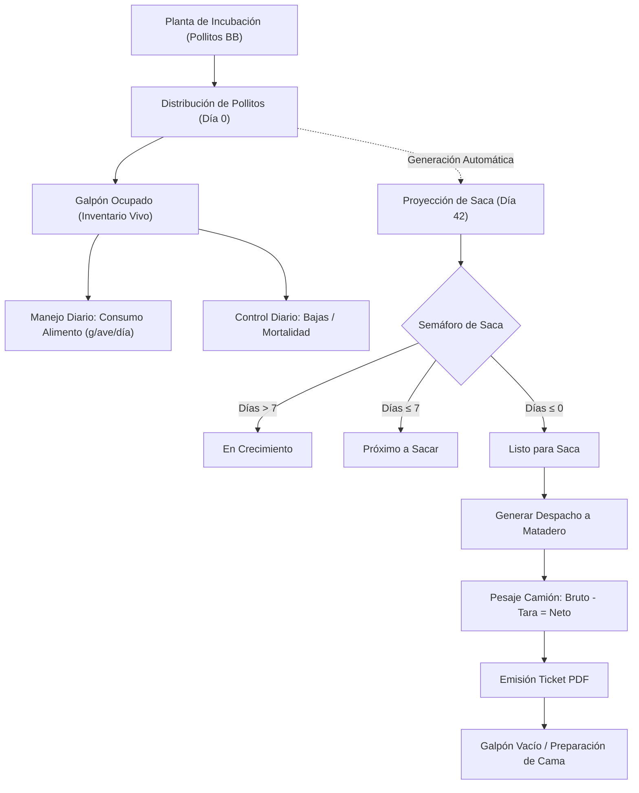

# 🐔 Gestión Avícola (Multi-Versión: Odoo 19, 18 y 17)

Módulo integral y profesional para la administración zootécnica, operativa y logística de granjas de engorde de pollos (*broilers*), con soporte para **Odoo 19.0, Odoo 18.0 y Odoo 17.0**.

---

## 🌿 Ramas por Versión de Odoo

Este repositorio cuenta con ramas adaptadas a cada versión de Odoo:

| Versión de Odoo | Rama en Git | Versión del Módulo | Características Técnicas de la Rama |
|---|---|---|---|
| **Odoo 19.0** | `master` | `19.0.1.0.0` | Vistas `<list>`, rutas dinámicas `/odoo`, API Odoo 19 (`post_init(env)`). |
| **Odoo 18.0** | `18.0` | `18.0.1.0.0` | Vistas `<list>`, rutas dinámicas `/odoo`, API Odoo 18 (`post_init(env)`). |
| **Odoo 17.0** | `17.0` | `17.0.1.0.0` | Vistas tradicionales `<tree>`, rutas `/web#action=...`, compatibilidad `(cr, registry)` y `groups_id`. |

---

## 📋 Índice
1. [Ramas por Versión de Odoo](#-ramas-por-versión-de-odoo)
2. [Descripción General](#-descripción-general)
3. [Estructura y Módulos Funcionales](#-estructura-y-módulos-funcionales)
   - [Panel de Control Ejecutivo (Dashboard)](#1-panel-de-control-ejecutivo-dashboard)
   - [Granjas y Galpones](#2-granjas-y-galpones)
   - [Distribución de Pollitos BB](#3-distribución-de-pollitos-bb)
   - [Proyecciones de Saca a Matadero](#4-proyecciones-de-saca-a-matadero)
   - [Salidas a Matadero y Despachos](#5-salidas-a-matadero-y-despachos)
   - [Alimento, Silos y Nutrición](#6-alimento-silos-y-nutrición)
   - [Control Sanitario y Mortalidad](#7-control-sanitario-y-mortalidad)
4. [Perfiles de Usuario y Seguridad](#-perfiles-de-usuario-y-seguridad)
5. [Flujo Operativo Estándar](#-flujo-operativo-estándar)
6. [Tutorial de Instalación y Despliegue](#-tutorial-de-instalación-y-despliegue)
7. [Ejecución de Pruebas Unitarias](#-ejecución-de-pruebas-unitarias)
8. [Licencia y Autoría](#-licencia-y-autoría)

---

## 🌟 Descripción General

El módulo **Gestión Avícola** centraliza todo el ciclo de vida del pollo de engorde, desde la recepción del pollito BB de 1 día de nacido hasta su cosecha y salida a matadero, cubriendo:

* **Control de Capacidad e Inventario Vivo:** Densidades ($aves/m^2$), ocupación en tiempo real por galpón y granja.
* **Proyecciones de Cosecha / Saca:** Estimación automatizada de fecha de extracción, peso objetivo, kilos proyectados, consumo de alimento y logística de jaulas/camiones requeridos.
* **Gestión de Alimento y Silos:** Despachos a silos de granjas, consumo diario por nave, cálculo automático de consumo diario ($g/ave/día$) y analítica dinámica de conversión alimenticia.
* **Logística de Despacho:** Control de pesaje (bruto, tara, neto), jaulas, choferes, placas, cuadrillas y emisión de ticket de despacho térmico en formato PDF (QWeb).
* **Dashboards SaaS Donezo UI:** Paneles visuales de alto rendimiento sin recargas pesadas, indicadores KPI interactivos y gráficos dinámicos con accesos directos funcionales.

---

## 📦 Estructura y Módulos Funcionales

### 1. Panel de Control Ejecutivo (Dashboard)
* **KPIs Clave en Tiempo Real:**
  * Población Total de Aves vivas activas.
  * Galpones activos vs. capacidad total instalada.
  * Total de pollitos ingresados en el ciclo.
  * Total de aves y kilogramos despachados a matadero.
* **Gráfica de Ocupación por Galpón:** Barras estilizadas que reflejan el nivel de carga de cada nave.
* **Velocímetro Gauge:** Porcentaje global de ocupación de granjas.
* **Control Sanitario:** Tasa de mortalidad acumulada global con semáforo de bioseguridad.
* **Accesos Directos 100% Operativos:** Botones superiores y flechas (`↗`) para navegar de inmediato a galpones, despachos, distribuciones, proyecciones y mortalidad.

### 2. Granjas y Galpones
* **Granjas (`avicola.granja`):**
  * Clasificación por tipo: Propia, Alquilada, Integrada.
  * Ubicación geográfica, capacidad máxima de aves y silos de almacenamiento.
  * Balance de alimento en silos (recibido vs. consumido).
* **Galpones (`avicola.galpon`):**
  * Dimensiones en metros cuadrados ($m^2$).
  * Capacidad máxima calculada según densidad zootécnica ($aves/m^2$).
  * Cantidad viva actual actualizada automáticamente con cada distribución, baja o despacho.
  * Estado operativo: Libre, En Crianza, En Despacho, En Vacío Sanitario.

### 3. Distribución de Pollitos BB
* Registro de llegada de lotes desde la planta de incubación (`avicola.distribucion`).
* Asignación por lote de incubadora, fecha, granja y galpón de destino.
* Validación automática de capacidad para evitar sobrepoblación en las naves.
* Al confirmar:
  * Suma el inventario de aves vivas al galpón seleccionado.
  * **Genera automáticamente la Proyección de Saca a Matadero** asociada al lote.
* Botón inteligente directo hacia su ficha de proyección.

### 4. Proyecciones de Saca a Matadero
* **Cálculo Dinámico por Lote (`avicola.proyeccion.lote`):**
  * **Edad actual:** Calculada automáticamente ($hoy - fecha\_ingreso$).
  * **Fecha proyectada de saca:** $fecha\_ingreso + edad\_objetivo$.
  * **Días restantes para cosecha:** Con semáforo de alerta (Próximo $\le 7$ días, Listo $\le 0$ días).
  * **Aves estimadas a sacar:** Considera la población viva y descuenta la mortalidad residual esperada.
  * **Kilos totales proyectados:** $aves\_estimadas \times peso\_objetivo$.
  * **Consumo de alimento estimado restante:** Utilizando el Índice de Conversión Alimenticia (ICA).
  * **Logística de transporte:** Cálculo automático de jaulas de transporte necesarias y camiones/viajes requeridos.
  * **Botón `+ Generar Despacho a Matadero`:** Abre un nuevo despacho pre-llenado con las aves estimadas, jaulas y kilos proyectados.
* **Vistas de Proyección:**
  * Vista de lista con semáforo por color según estado (Listo, Próximo, Crecimiento, Sacado).
  * Vista de Calendario mensual/semanal para planificación de extracciones.
  * Gráficas de kilos proyectados por mes y matrices pivot de cosecha.
* **Configuración de Parámetros de Saca (`avicola.proyeccion.config`):**
  * Ubicada en **Configuración > Parámetros de Saca**.
  * Permite al usuario ajustar libremente ("moverle"):
    * Edad objetivo de saca (días).
    * Peso promedio objetivo (kg/ave).
    * Ganancia diaria de peso (g/día).
    * Mortalidad estimada acumulada (%).
    * Índice de Conversión Alimenticia esperado (ICA).
    * Aves por jaula y jaulas por camión de transporte.
    * Días de aviso previo y precio de venta estimado ($/kg).
  * Botón `⚡ Aplicar a Todos los Lotes Activos`: Recalcula al instante las fechas, pesos y camiones de todos los lotes en engorde con un solo clic.

### 5. Salidas a Matadero y Despachos
* Módulo unificado para ventas en pie y salidas a matadero (`avicola.despacho`).
* Numeración correlativa automática por ticket (ej. `DSP-202610-0001`).
* Descuento automático del inventario vivo del galpón seleccionado al confirmar.
* Datos de transporte y trazabilidad: Chofer, cédula, placa, cuadrilla de agarre, precintos y jaulas.
* Control de pesaje: Peso Bruto, Tara del camión y Peso Neto descontado.
* **Impresión de Ticket PDF (QWeb):** Formato térmico tipo ticket con desglose de pesaje, promedio por ave y firmas de despacho y recepción.

### 6. Alimento, Silos y Nutrición
* **Tipos y Fórmulas (`avicola.alimento.tipo`):**
  * Clasificación por fases: Pre-iniciador, Iniciador, Crecimiento, Engorde/Finalizador, Retiro.
  * Valores nutricionales: % Proteína Cruda, Energía Metabolizable ($kcal/kg$), costo por kg.
* **Despachos a Silos (`avicola.alimento.despacho`):**
  * Registro de envíos a granjas (a granel o sacos de 40 kg).
  * Incremento automático del stock disponible en los silos de la granja receptora.
* **Consumo Diario por Galpón (`avicola.alimento.consumo`):**
  * Registro diario por galpón y fase de alimento.
  * Cálculo instantáneo del ratio de consumo en gramos ($g/ave/día$).
  * Validación estricta de stock disponible en silo para evitar consumos negativos.
* **Analítica Dinámica de Consumo:**
  * Vista gráfica en barras apiladas por fórmula y granja.
  * Vista en gráfico de torta con proporciones nutricionales sólidas y legibles.
  * Tablas pivot multidimensionales por granja, galpón y fase de alimento.
  * Dashboard especializado de Alimento y Silos.

### 7. Control Sanitario y Mortalidad
* **Registro de Mortalidad (`avicola.mortalidad`):**
  * Reporte diario de bajas por galpón con causas (térmica, metabólica, asfixia, selectiva).
  * Descuento en tiempo real de la población viva del galpón.
  * Cálculo dinámico de la tasa de mortalidad acumulada (%) por lote y por granja.
* **Planificación de Vacunación (`avicola.plan.vacunacion`):**
  * Calendario de intervenciones sanitarias (Newcastle, Gumboro, Bronquitis).
  * Veterinario responsable, dosis, método de aplicación (agua, aspersión, ocular) y estado de ejecución.
* **Equipo Veterinario (`avicola.veterinario`):**
  * Asignación de médicos veterinarios y supervisores técnicos a granjas específicas.

---

## 👥 Perfiles de Usuario y Seguridad

El módulo implementa un modelo de seguridad por roles basado en grupos de Odoo:

| Rol / Grupo | Nombre Técnico | Permisos y Alcance |
| :--- | :--- | :--- |
| **Avícola / Veterinario** | `gestion_avicola.group_veterinario` | **Operador de Campo y Médico Veterinario:**<br>• Registro diario de mortalidad.<br>• Creación y confirmación de consumos de alimento.<br>• Creación de despachos y salidas a matadero.<br>• Consulta de galpones, proyecciones de saca y calendarios.<br>• Consulta de dashboards. |
| **Avícola / Administrador** | `gestion_avicola.group_veterinario_manager` | **Gerente de Producción / Director Técnico:**<br>• Todos los permisos de Veterinario.<br>• Creación, edición y archivo de Granjas y Galpones.<br>• Ajuste de **Parámetros de Saca** y recálculo masivo.<br>• Creación y configuración de Fórmulas de Alimento.<br>• Confirmación y reversión de distribuciones de pollitos.<br>• Asignación de veterinarios a granjas. |
| **Administrador del Sistema** | `base.group_system` | Acceso técnico total, auditoría de base de datos y configuración de reportes. |

---

## 🔄 Flujo Operativo Estándar



---

## 💻 Tutorial de Instalación y Despliegue

### Requisitos Previos
* **Odoo:** Versión 19.0, 18.0 o 17.0 (Community o Enterprise).
* **Python:** 3.10 o superior (Python 3.10 / 3.11 para Odoo 17, Python 3.11 / 3.12 para Odoo 18/19).
* **Base de Datos:** PostgreSQL 14 o superior.

### Paso 1: Clonar el Repositorio según tu Versión de Odoo

Ubica tu terminal en el directorio de `custom_addons` de tu servidor Odoo y clona la rama correspondiente:

#### Para Odoo 19.0 (Rama `master`):
```bash
cd /ruta/a/tu/odoo/custom_addons/
git clone -b master https://github.com/JuanDiego3030/gestion_avicola.git
```

#### Para Odoo 18.0 (Rama `18.0`):
```bash
cd /ruta/a/tu/odoo/custom_addons/
git clone -b 18.0 https://github.com/JuanDiego3030/gestion_avicola.git
```

#### Para Odoo 17.0 (Rama `17.0`):
```bash
cd /ruta/a/tu/odoo/custom_addons/
git clone -b 17.0 https://github.com/JuanDiego3030/gestion_avicola.git
```

> [!TIP]
> Si ya habías clonado el repositorio y deseas cambiar de rama, simplemente navega a la carpeta del módulo y cambia de rama con:
> ```bash
> cd gestion_avicola
> git fetch origin
> git checkout 18.0   # o 17.0 / master
> ```

### Paso 2: Verificar la Configuración de Odoo (`odoo.conf`)
Asegúrate de que la ruta hacia `custom_addons` esté incluida en el parámetro `addons_path` de tu archivo `odoo.conf`:

```ini
[options]
addons_path = /ruta/a/odoo/addons,/ruta/a/tu/odoo/custom_addons
```

### Paso 3: Instalar el Módulo

#### Opción A: Desde la Línea de Comandos (Recomendado)
Detén el servicio de Odoo y ejecuta la instalación indicando la base de datos:

```bash
# Instalación inicial
python3 odoo-bin -c odoo.conf -d tu_base_de_datos -i gestion_avicola --stop-after-init

# O actualización si ya existía una versión anterior
python3 odoo-bin -c odoo.conf -d tu_base_de_datos -u gestion_avicola --stop-after-init
```

Inicia Odoo normalmente:
```bash
python3 odoo-bin -c odoo.conf
```

#### Opción B: Desde la Interfaz Web de Odoo
1. Ingresa a Odoo como **Administrador** (`admin`).
2. Activa el **Modo Desarrollador** (*Ajustes > Activar modo desarrollador*).
3. Dirígete al menú **Aplicaciones**.
4. En la barra superior, haz clic en **Actualizar Lista de Aplicaciones**.
5. En el buscador, elimina el filtro *"Aplicaciones"* y busca `Gestión Avícola`.
6. Haz clic en el botón **Activar / Instalar**.

---

## 🧪 Ejecución de Pruebas Unitarias

El módulo cuenta con una suite completa de pruebas unitarias automatizadas (`TransactionCase`) que validan el ciclo zootécnico, el inventario, los cálculos de saca y el consumo de alimento.

Para correr las pruebas:

```bash
python3 odoo-bin -c odoo.conf -d tu_base_de_datos -u gestion_avicola --test-enable --stop-after-init
```

### Pruebas que se ejecutan:
1. `test_01_granja_and_galpon_initial_state`: Integridad de granjas, galpones y densidades.
2. `test_02_distribucion_pollitos`: Asignación de pollitos y aumento de stock en galpón.
3. `test_03_mortalidad_registro`: Registro de bajas y deducción de población.
4. `test_04_despacho_aves_vivas`: Salida a matadero, cálculo de peso neto y reporte PDF.
5. `test_05_dashboard_metrics`: Cálculo de KPIs y métricas zootécnicas globales.
6. `test_06_alimento_despacho_y_consumo`: Abastecimiento de silos, consumo diario ($g/ave/día$) y validación de stock.
7. `test_07_proyecciones_saca`: Cálculo automatizado de fecha de cosecha, ajuste dinámico de parámetros de saca y despacho precargado.

Resultado esperado:
```text
INFO: 0 failed, 0 error(s) of 7 tests when loading database 'tu_base_de_datos'
```

---

## 📄 Licencia y Autoría
* **Desarrollador:** Juan Diego Arana Pérez
* **Repositorio:** [https://github.com/JuanDiego3030/gestion_avicola.git](https://github.com/JuanDiego3030/gestion_avicola.git)
* **Licencia:** LGPL-3 (`LGPL Version 3`)
* **Categoría Odoo:** Agriculture
